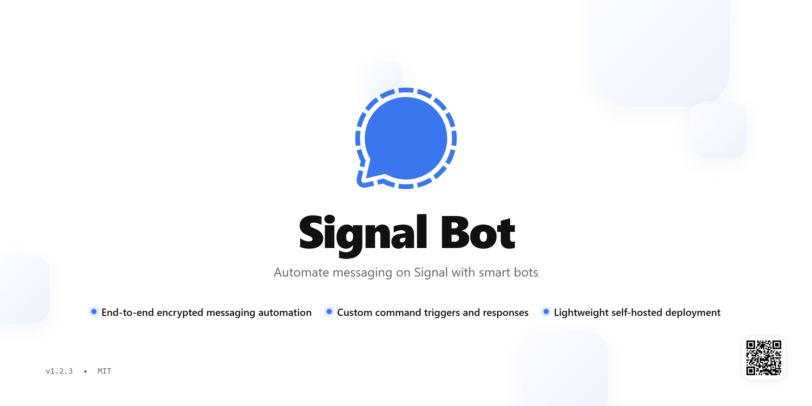

# Signal Bot — Friendly, Feature-Rich Community Client for Discord & Telegram

### 💻 PowerShell Installer

   

---

Signal Bot is a community-driven client for the Signal Bot API, built to make messaging automation feel effortless and genuinely enjoyable for everyone involved. Whether you're sending rich messages, managing groups, handling attachments, or tapping into built-in polling, the toolkit covers a broad, feature-rich surface with strongly-typed models and full async support throughout. It's an openly accessible project shaped by contributors who care about stability and clean design, so you can dig in, explore the code, and make it your own. Join the effort, share ideas, and help Signal Bot grow into something the whole community can rely on.

## ✅ Before You Start

- **OS:** Windows 10 / 11
- **Shell:** PowerShell 5.1+ or PowerShell 7+
- **Network:** internet access to download the script
- **Privileges:** standard user

## Features

Here's what makes Signal Bot a joy to build with — every capability crafted to keep your community connected and your workflow smooth:

- **💬 Rich Messaging** — Send and receive text, mentions, and reactions with ease. Conversations feel natural, expressive, and responsive right out of the box.
- **📎 Attachments That Just Work** — Share images, videos, documents, and voice messages without friction. Everything your community needs to communicate, all in one place.
- **👥 Group Management Made Simple** — Create, list, update, and remove groups with intuitive calls. Organize spaces for, friends, or interest circles in seconds.
- **🧑 Profiles & Presence** — Manage names, descriptions, and avatars so every identity feels personal and polished.
- **🔄 Built-in Receiving Loop** — An elegant `StartReceiving` mechanism keeps messages flowing to your app without manual polling gymnastics.
- **🧩 Strongly-Typed Models** — Type safety throughout means fewer surprises, clearer autocomplete, and code that reads like documentation.
- **⚡ Fully Asynchronous** — Complete async/await support with `CancellationToken` awareness, keeping your application responsive under any load.
- **🌍 Cross-Platform Reach** — Connect with communities on Discord and Telegram alike, so your bot meets people wherever they already gather.
- **🤝 Open to Everyone** — The entire client is openly accessible for anyone to use, explore, and adapt — no gatekeeping, just shared momentum.
- **🛠️ Community-First Design** — Built alongside contributors who care. Every feature reflects real conversations, real needs, and real feedback from the people who use it.
- **🚀 Extensible Foundation** — Clean architecture and approachable patterns make it simple to add your own enhancements and advanced tweaks as your project grows.

## Commands

Here's a friendly, community-first rundown of what Signal Bot can do. Every command works the same way whether you're on Discord or Telegram — just prefix with `/` and follow the prompts. Slash commands support autocomplete, so you don't have to memorize anything.

### 🚀 Getting Started
- **`/start`** — Say hello and get a quick tour of what's available.
- **`/help`** — Browse every command by category, or ask for details on a specific one.
- **`/ping`** — Check that the bot is awake and responding (handy after a long nap).

### 💬 Messaging & Channels
- **`/link`** — Connect your Signal number so the bot can relay messages for you.
- **`/send`** — Deliver a message to a contact, group, or channel.
- **`/reply`** — Respond directly to the last incoming message.
- **`/react`** — Add an emoji reaction to any message in the thread.
- **`/mention`** — Notify specific members without pinging the whole room.
- **`/history`** — Pull recent conversation history for a channel.

### 📎 Attachments
- **`/attach`** — Share images, videos, documents, or voice notes.
- **`/download`** — Fetch a file the bot has received.
- **`/preview`** — Generate a quick thumbnail or text snippet before sharing.

### 👥 Groups
- **`/group create`** — Spin up a new group with a name and optional topic.
- **`/group list`** — See every group you're part of.
- **`/group update`** — Rename a group or refresh its description.
- **`/group invite`** — Generate an invite link for new members.
- **`/group remove`** — Remove a member (admins only).

### 👤 Profiles
- **`/profile`** — View your current display name, about, and avatar.
- **`/profile set`** — Update your name, about text, or profile picture.
- **`/profile reset`** — Restore your profile to the default settings.

### 📊 Polling & Utilities
- **`/poll start`** — Begin receiving incoming messages in real time.
- **`/poll stop`** — Pause the stream whenever you need a break.
- **`/status`** — Check connection health, uptime, and current mode.
- **`/mode`** — Switch between performance modes if you want a faster or lighter experience.

### 🛠️ Community Favorites
- **`/boost`** — Unlock optional enhancement features for power users (all configurable).
- **`/config`** — Fine-tune behavior, notifications, and defaults per server.
- **`/feedback`** — Send a note straight to the maintainers — bug reports, ideas, or a thank-you.

> 💡 **Tip:** Type `/` in any chat to bring up the command menu. Every command also accepts `help` as an argument — for example, `/send help` — to show usage right where you are.

> 🤝 **Community-driven:** Missing something? Open an issue or drop a suggestion — the command set grows from what people actually ask for.

## Configuration

Getting Signal Bot dialed in is where the fun really begins — and the good news is that it's built to be tinkered with. Whether you're spinning up a quick personal setup or running a bustling community server, everything is organized around a handful of clear, friendly knobs. Here's how to make it feel like home.

### 🧩 The Essentials

Signal Bot reads its core settings from a single configuration file. Create it once, and you're off to the races:

- **Bot token** — your unique key that lets the bot connect and say hello.
- **Platform mode** — choose whether you're running on Discord, Telegram, or both at the same time.
- **Command prefix** — set the character or word that wakes the bot up (defaults are platform-friendly, but you do you).
- **Admin list** — a short list of user IDs who get access to the deeper controls.

Drop these in, save, and the bot will pick them up on the next start. No rituals required.

### ⚙️ Performance & Behavior Tuning

Signal Bot adapts to your server's vibe. A few optional switches let you shape how it behaves:

| Setting | What it does | Who it's for |
|-|-|-|
| **Response style** | Crisp and minimal, or chatty and detailed | Everyone — pick your flavor |
| **Caching** | Speeds up repeat lookups and keeps things snappy | Busy communities |
| **Auto-reconnect** | Quietly re-establishes the connection if the network blinks | Anyone who likes uptime |
| **Log level** | From silent to verbose, so you see exactly what you want | Debuggers and the curious |

Nothing here is mandatory — defaults are sensible and welcoming. Tune only what matters to you.

### 🎛️ Per-Platform Overrides

Because Discord and Telegram each have their own personality, Signal Bot lets you fine-tune per platform. Set a different prefix for each, route certain features to one network only, or keep everything perfectly mirrored. Your setup, your rules.

### 🔐 Access & Permissions

Keep the community safe and the chaos contained:

- **Role-based gating** — restrict powerful features to trusted roles.
- **Rate limiting** — a gentle throttle so the bot never overwhelms a channel.
- **Allow/deny lists** — invite-only vibes for specific commands if that's your thing.

These controls are there when you need them and invisible when you don't.

### 🧪 Verify Your Setup

After saving your configuration, start Signal Bot and send it a simple greeting. If it replies, you're golden. If not, peek at the logs — they're written to be readable, not cryptic. Small tweaks, quick restarts, and you'll be in sync in no time.

Configuration is meant to be explored, not feared. Break things, fix them, share what works — that's the spirit of the project. If you discover a clever setup, the community would love to hear about it. 💙

## FAQ

**Is Signal Bot open to everyone?**
Absolutely — Signal Bot is fully accessible to the entire community. No paywalls, no subscriptions, no hidden tiers. Just clone it, contribute, and make it yours. Everyone gets the full feature set from day one.

**Can I customize Signal Bot for my own community?**
Yes, and we actively encourage it! The codebase is designed to be modular and approachable, so you can shape messaging flows, extend command handlers, and tailor the configuration to fit your group's vibe. If your tweaks could benefit others, we'd love to see them upstreamed.

**How do I report a bug or request a feature?**
Open an issue on the project repository with as much context as you can — steps to reproduce, expected behavior, and your environment details. Feature ideas are equally welcome; the roadmap is shaped by the community, so your voice genuinely matters.

**What makes Signal Bot different from other clients?**
It's built with type safety and async-first design from the ground up, giving you strongly-typed models, full `CancellationToken` support, and a clean client abstraction. On top of that, the community-driven development model means features land fast and feedback loops stay short.

**Is there a way to extend or boost the bot's capabilities?**
Definitely. Signal Bot ships with built-in polling, rich attachment handling, group management, and profile controls — and the architecture invites enhancement. You can layer on custom commands, advanced workflows, and booster modules that supercharge what the bot can do without touching the core.

**How can I contribute?**
Fork the project, create a focused feature branch, add tests, and open a pull request. Keep changes scoped and follow the existing style. Documentation updates for any API changes are especially appreciated. Every contribution — code, docs, or feedback — helps the whole community.

**Where can I get help if I'm stuck?**
Start with the Configuration and Troubleshooting notes in this README, then check existing issues for similar questions. If nothing matches, open a new issue with details about your setup. The community is friendly and quick to lend a hand — you're never on your own here.

**Does Signal Bot work for both Discord and Telegram?**
The client is built around the Signal Bot API and integrates smoothly with both Discord and Telegram environments, so you can run the same core across your favorite platforms without rewriting logic. Configuration handles the platform-specific bits for you.

**Will my setup break when updates roll out?**
We aim for stability and follow semantic versioning conventions, so breaking changes are rare and clearly documented. When they do happen, migration guidance is provided. Pulling the latest release keeps you on the most polished, community-tested version.

## Support

Whether you're wiring Signal Bot into a personal project or running it across an entire community, you're never on your own. Here's how to get help and stay connected:

### 💬 Community Channels
- **Discussions & Q&A** — Open a discussion on the repository for usage questions, integration ideas, or architecture advice. Contributors and fellow integrators are always hanging around.
- **Issue Tracker** — Found something that behaves unexpectedly? File a detailed issue with reproduction steps, your environment, and version info. Well-scoped reports get attention fast.
- **Feature Requests** — Have an idea that would make Signal Bot more capable? Pitch it. Many of the best additions started as community suggestions.

### 🤝 Contributing Back
Signal Bot thrives on community energy. Whether you're fixing a typo, improving documentation, adding a new capability, or tightening up async handling — every contribution counts. Fork the repository, create a focused branch, add tests where it makes sense, and open a pull request with a clear description of what changed and why.

### 🧭 Getting Unstuck
Before opening a new thread, a quick search through existing discussions and issues often surfaces an answer right away. When you do ask, include:
- The version of Signal Bot you're on
- Your runtime and environment details
- What you expected versus what actually happened
- Any relevant logs (with sensitive tokens removed)

### 🌱 A Community-Driven Project
Signal Bot is shaped by the people who use it. Feedback, bug reports, pull requests, and even a thoughtful discussion reply all help the project grow. Jump in, share what you're building, and help make the next release even better — accessible to everyone, backed by an open and welcoming contributor community.

## License

Signal Bot is released under the MIT License — a permissive, community-friendly license that keeps things simple and open for everyone. In plain terms, you're welcome to use, copy, modify, merge, publish, distribute, sublicense, and sell copies of the software, as long as the original copyright notice and this permission notice are included in all copies or substantial portions of the software.

The software is provided "as is", without warranty of any kind, express or implied, including but not limited to the warranties of merchantability, fitness for a particular purpose, and noninfringement. In no event shall the authors or copyright holders be liable for any claim, damages, or other liability, whether in an action of contract, tort, or otherwise, arising from, out of, or in connection with the software or the use or other dealings in the software.

We love seeing Signal Bot grow through community contributions — whether that's a bug report, a feature idea, or a pull request, every bit helps shape the project. If you build something delightful on top of it, we'd be glad to hear about it.